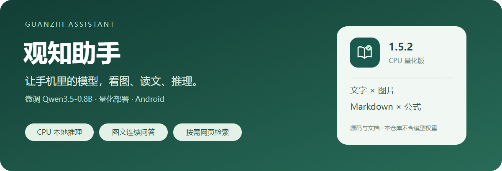
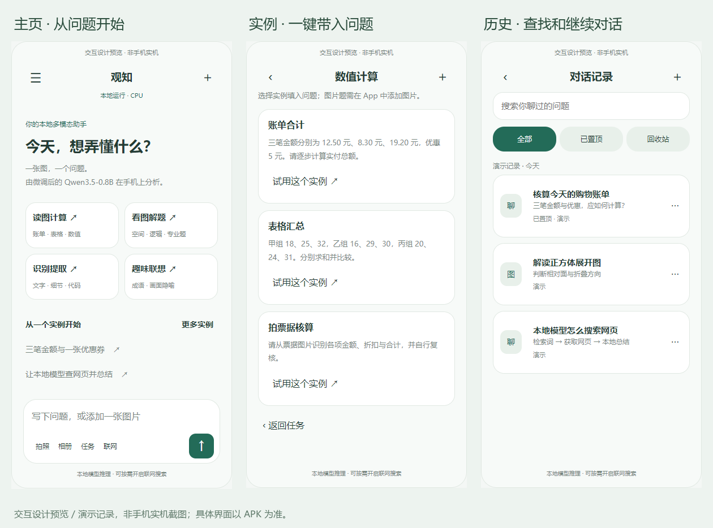
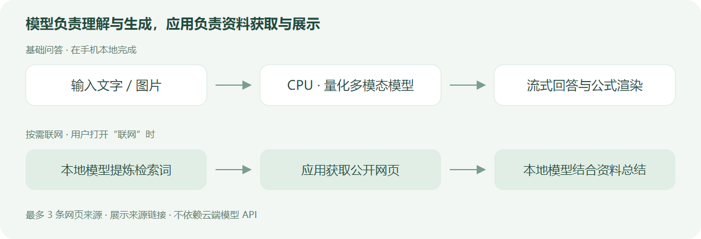
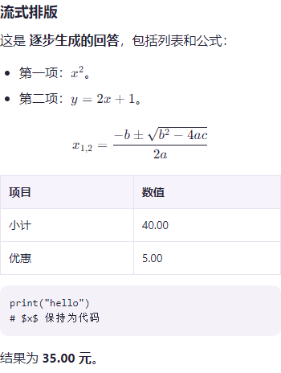

# 观知助手 · Guanzhi Assistant



**基于微调、量化后的 Qwen3.5-0.8B，在 Android 手机上本地运行的多模态助手。**

观知助手把文字和图片交给同一本地模型，支持看图问答、文字提取、数值分析、空间推理、代码解读和学习辅助。用户按需打开联网搜索后，由本地模型提炼检索词，应用读取公开网页，最后由本地模型结合资料总结。

当前 Android 发布版本为 **1.5.2 CPU 量化版**。本仓库保存应用源码、资源、脚本和文档，**不包含模型权重、含权重的完整 APK、签名密钥或训练数据**。

- [完整使用手册（Markdown）](docs/USER_GUIDE.zh-CN.md)
- [完整使用手册（PDF）](docs/USER_GUIDE.zh-CN.pdf)
- [下载不含模型的升级包](https://github.com/yeshuangtang-svg/guanzhi-assistant/releases/tag/v1.5.2)
- [权重发布方式](#模型权重如何发布)

## 界面与工作流程



*交互设计预览，展示演示记录，非手机实机截图；实际界面以 APK 为准。可打开 [本地交互预览](docs/previews/mobile.html) 查看。*



## 项目状态

| 项目 | 当前状态 |
| --- | --- |
| Android | Android 9+，ARM64，CPU 本地推理 |
| 模型 | 用户微调后的 Qwen3.5-0.8B，量化并适配为 GGUF |
| GPU | Android 当前版本已移除 GPU 切换、初始化与 Vulkan 后端 |
| iOS | `ios/` 为早期适配草稿，尚未完成 Xcode 构建、签名和 iPhone 验证 |
| 在线模型 API | 当前没有提供公网模型 API，也不依赖云端模型生成回答 |
| 验证范围 | 已完成构建、签名、权重完整性、电脑 CPU 图文推理及渲染检查；手机性能需实测 |

## 可以做什么

### 模型任务

应用提供 **11 类任务、33 个任务示例**，另有 3 个自由提问示例。图片示例需要用户添加图片，示例不内置答案。

| 任务 | 示例场景 |
| --- | --- |
| 数值计算 | 提取账单或表格数字，列式求和、扣除优惠、按给定条件换算 |
| 图形计数 | 清点字母、物体或相交三角形，说明分组与去重依据 |
| 空间折叠 | 根据展开图分析相邻面、相对面，核对立体图形选项 |
| 物理常识 | 根据水管连通、堵塞与高度条件分析示意图 |
| 局部细节 | 判断颜色、方位、姿态及人物左右手等局部信息 |
| 图文联想 | 结合图像线索猜成语、解释隐喻 |
| 代码分析 | 转写截图代码，解释控制流程并分析复杂度；不执行图片中的程序 |
| 数学与化学 | 核对题目符号、结构和条件，生成推导或分析 |
| 文字提取 | 提取指定区域文字，保留阅读顺序，标记不清楚字符 |
| 图形规律 | 比较形状、数量、颜色、方向与位置，验证候选规律 |

上表将数学和化学合并展示，应用内是两个独立入口。识字、计算和推理的答案由本地模型生成；图片裁剪、网页提取、资料筛选与界面排版由程序完成。任务入口不代表专项准确率评测，关键金额、字符和专业结论应核对。

### 使用体验

- **实时排版**：流式 Markdown、表格、代码和 KaTeX 公式显示。
- **图片工作台**：裁剪、放大与位置标记，便于明确关注区域。
- **资料问答**：导入 TXT、Markdown 和 PDF；PDF 最多前 5 页由本地模型转写，每页最多 1024 tokens。
- **历史管理**：正文搜索、置顶、重命名、草稿恢复、回收站、备份与导入。
- **本地模型结合网页**：无需搜索 API Key，获取最多 3 条公开来源的正文节选，展示检索词和来源链接。
- **运行设置**：CPU 4/6/8 线程；图像预算 256/384/768 tokens；回答上限 512/1024/2048/4096 tokens；防重复生成与诊断。

### Markdown 与公式排版



*使用应用中的同一套 HTML/KaTeX 渲染资源生成的本地浏览器测试截图，内容为排版样例，不代表模型回答准确率。*

## 安装与使用

### 已有模型的手机

从 [v1.5.2 Release](https://github.com/yeshuangtang-svg/guanzhi-assistant/releases/tag/v1.5.2) 下载 `Guanzhi-1.5.2-Update-arm64.apk`（4,190,856 字节，约 4.19 MB），直接覆盖安装，复用手机内的量化模型和历史记录。

**不要先卸载或清除应用数据。** 当前升级包沿用已交付版本的签名；自行生成不同签名的 APK 无法覆盖它。

### 首次使用

不含权重的升级包不能在没有模型的手机上独立完成推理。首次安装需要由模型持有者提供量化权重后构建完整 APK，或直接提供已构建的完整 APK。本次 GitHub 上传没有分发这两种含权重内容。

1. 安装含模型的完整 APK，启动应用并等待模型准备完成。
2. 状态显示“本地运行 · CPU”后发送文字问题。
3. 看图任务先添加图片，必要时裁剪目标区域；可从“任务与资料 → 看图问答”选择示例。
4. 需要网页资料时打开输入框下方的“联网”；需要本机资料时在“资料问答”中导入并启用资料。

完整 APK 约 1.05 GB，手机安装后还需存放展开的模型与运行数据。建议为首次部署预留至少 4 GB 存储；该值是空间准备建议，不是实测最低配置。

## 模型与运行参数

| 参数 | 当前实现 |
| --- | --- |
| 基础模型 | 微调后的 Qwen3.5-0.8B |
| 语言权重 | 混合 Q4_0/Q8_0，少量参数为浮点 |
| 视觉权重 | Q8_0，少量参数为浮点 |
| 格式与引擎 | GGUF、llama.cpp；引擎提交固定在 `engine-version.json` |
| 上下文 | 8192 tokens，问题、图片、资料和回答共同使用 |
| 最大生成长度 | 可选至 4096 tokens，模型可以提前结束 |
| 默认 CPU 设置 | 生成 4 线程，预处理 6 线程 |
| 默认图像预算 | 384 tokens |

完整构建需要把以下文件放入 `app/src/main/assets/models/`。`manifest.json` 已提交，权重本体被 `.gitignore` 排除。

| 文件 | 字节数 | SHA-256 |
| --- | ---: | --- |
| `model-allint-w4w8.gguf` | 933766240 | `94f6b38b3462add69b1e4b38b31e609e157997246409c92b08c480641bcc0bbf` |
| `vision-allint-q8.gguf` | 115923168 | `c55789b46431073b4ccd87d22cfbd0ef85a54cfaadad066e2084dc6e1c4646aa` |

## 开发与构建（Windows）

当前自动化脚本面向 Windows。准备 Git、Python 3.11+ 和 JDK 21，并在 PowerShell 中进入项目目录。

### 1. 准备开发依赖

```powershell
git clone https://github.com/yeshuangtang-svg/guanzhi-assistant.git
cd guanzhi-assistant
$env:JAVA_HOME = 'C:\path\to\jdk-21'
python scripts/bootstrap.py
```

`bootstrap.py` 下载固定提交的 llama.cpp、Android SDK 35、NDK 28.2.13676358、CMake 3.31.6 与 Ninja；Gradle 8.9 会在打包时准备。首次运行需要访问 GitHub、Google Android 下载源及 Gradle/Maven 仓库。依赖保存在 `.tools/` 和 `vendor/`，不随源码仓库提交。`QWEN_JAVA_HOME` 可单独覆盖 `JAVA_HOME`。

### 2. 配置自己的签名

```powershell
New-Item -ItemType Directory -Force .tools | Out-Null
& "$env:JAVA_HOME\bin\keytool.exe" -genkeypair -keystore .tools\qwenpocket-release.keystore -alias qwenpocket -keyalg RSA -keysize 3072 -validity 10000
$env:QWEN_STORE_PASSWORD = [System.Net.NetworkCredential]::new('', (Read-Host '签名库口令' -AsSecureString)).Password
```

工具会交互询问签名信息。口令从环境变量传给签名程序，不写入仓库；`QWEN_KEY_PASSWORD` 未设置时沿用签名库口令。还可设置 `QWEN_KEYSTORE` 指向自己的签名库、`QWEN_KEY_ALIAS` 指定别名。必须保留签名密钥以便后续覆盖更新。

### 3. 构建安装包

```powershell
python scripts/build_native.py
python scripts/build_tools_apk.py
# 仅在已准备两个 GGUF 文件后执行完整包构建：
python scripts/build_tools_apk.py --full
python scripts/verify_bundle.py dist/Guanzhi-1.5.2-Lite-W4W8-arm64.apk
```

输出位于 `dist/`。不带 `--full` 可在缺少模型权重的源码环境中生成升级包；手机实际推理仍需要模型。`scripts/build_apk.py --update` 是保留的兼容构建入口。

### 4. 可选验证与局域网更新

```powershell
python -m pip install -r requirements-dev.txt
python -m playwright install chromium
python scripts/check_streaming_answers.py
python scripts/check_phone_update.py
python scripts/render_readme.py
```

流式排版测试使用本机浏览器，不能替代 Android WebView 实机验证。更新工具测试不启动网络监听；需在 `dist/` 中已有不含权重的 Update APK。

需要给同网手机传输更新时，手动运行根目录 `启动手机更新.cmd`，按提示扫码下载。该服务只分享升级包，默认不启动，运行后会在两小时后结束。

## 目录说明

```text
app/src/main/java/       Android 对话、任务、资料、历史与设置
app/src/main/cpp/        JNI 与 CPU 语言/视觉推理
app/src/main/assets/     渲染资源、许可与模型元数据（没有权重）
scripts/                构建、转换、验证与更新脚本
docs/                   正式 PDF / Markdown 手册
ios/                    未完成发布的 iOS 适配草稿
engine-version.json     固定的 llama.cpp 源码提交
```

`scripts/` 保留部分早期 BF16 转换、对照实验与界面预览脚本，可能依赖未分发的旧模型、测试数据或工具；它们不是当前 CPU 量化包的构建前置步骤。当前发布流程以上方列出的脚本为准。

## 模型权重如何发布

本次提交不上传任何模型权重，以下是后续单独发布时的操作说明。

### 方式一：GitHub Releases（本项目更适合）

GitHub 普通 Git 仓库拒绝大于 **100 MiB** 的文件，网页直接提交文件的限制为 **25 MiB**；本项目两个 GGUF 文件都超过普通 Git 单文件上限。[GitHub 大文件说明](https://docs.github.com/en/repositories/working-with-files/managing-large-files/about-large-files-on-github)

在仓库 **Releases → Draft a new release** 中，为模型新建例如 `model-v1` 的独立版本，将两个 GGUF、模型 manifest 和校验摘要作为附件上传，再发布 Release。按 GitHub 的 Release 文档，每个附件须小于 **2 GiB**，本项目两份权重均符合。源码历史中只保留说明和下载链接，无需反复克隆大权重。[GitHub Releases 限制](https://docs.github.com/en/repositories/releasing-projects-on-github/about-releases)

私有仓库的附件需要访问权限；公开仓库的附件可被公众下载。发布权重前需明确相应的分发范围和许可。

### 方式二：Git LFS（需要对权重做版本管理时）

Git LFS 在 Git 中保存指针，权重放在 LFS 存储中。Free / Pro 的单文件限制为 2 GB，Team 为 4 GB，Enterprise Cloud 为 5 GB；存储和下载流量受账户额度与计费规则影响。[LFS 文件限制](https://docs.github.com/en/repositories/working-with-files/managing-large-files/about-git-large-file-storage) · [LFS 计费](https://docs.github.com/en/billing/concepts/product-billing/git-lfs)

建议在**单独的权重仓库**中配置，而不是直接对本仓库忽略的文件强制提交：

```powershell
git lfs install
git lfs track '*.gguf'
git add .gitattributes
git add models/model-allint-w4w8.gguf models/vision-allint-q8.gguf
git commit -m 'Add quantized model weights with Git LFS'
git push origin main
```

上述命令需要先安装 Git LFS、克隆或建立目标权重仓库，并把实际文件放入 `models/`。仅运行 `git lfs track` 不会上传文件，也不会自动迁移已进入普通 Git 历史的大文件。

## 隐私、限制与验证

- 基础问答在手机本地执行。开启联网后会发送模型生成的检索词；不上传图片、历史对话或本机资料，网页请求仍包含常规网络连接信息。
- 当前网页搜索读取公开页面，网络限制、验证页面和网站结构变化可能影响结果。
- 小模型可能算错、漏数或识别错误，较长上下文与精细图片也会增加耗时。增加线程不保证更快。
- 1.5.2 已验证 APK 版本与签名、两份权重的哈希、CPU 专用后端、电脑 CPU 文字/图片推理、历史数据兼容和实时排版；未把电脑测试结果作为手机速度或专项准确率指标。

## 项目与许可

观知助手为独立开发项目，与千问官方无关联。基础模型及第三方组件按各自许可使用，见 [NOTICE.md](NOTICE.md) 和 `app/src/main/assets/licenses/`。本次仓库上传没有自动开放模型权重，也没有为自有源码新增开源授权；分发与使用范围由权利人明确决定。